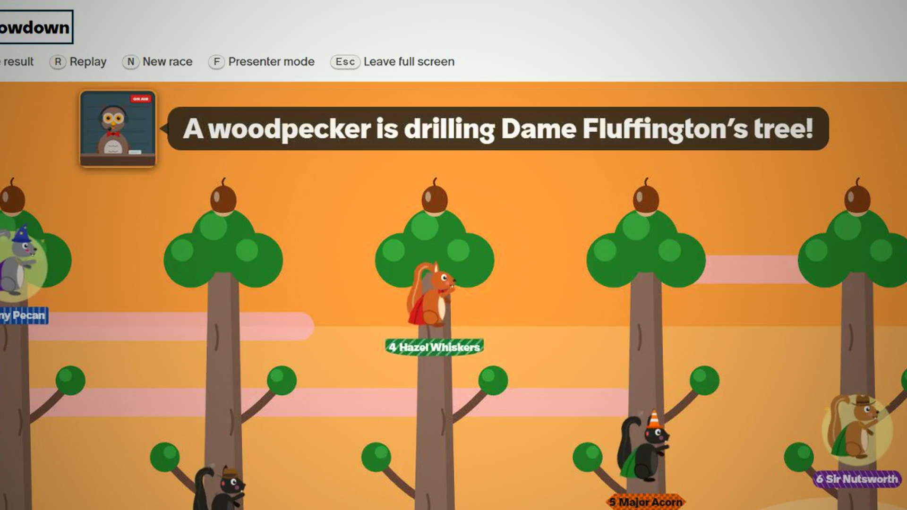

# 🐿️ Squirrel Scramble

**A squirrel race game for ServiceNow, built on the Lux (AIUX) framework.**

Can't decide who buys the coffee, who takes the next on-call shift, or who presents first? Put everyone's
name on a squirrel, dress them up, and let them race up the trees. Turn on **Chaos mode** and things get
silly: tornadoes swap squirrels between trees, hunters show up, suitors cause swooning, and an owl in
the commentary booth shouts about all of it.

> Built for the **AIUX Game Challenge**. One update set installs the whole game: tables, the race engine,
> the REST API, roles, menus and the Lux pages.



🎬 **Trailer:** [media/squirrel-scramble-trailer.mp4](media/squirrel-scramble-trailer.mp4)

---

## What's in the game

- **Up to 50 racers.** Type names in, or load a whole group from ServiceNow in one go.
- **A wardrobe.** Hats, capes, accessories and fur, from Common to Legendary (rainbow fur, anyone?).
  Pick outfits yourself or let the game dress everyone at random.
- **Classic or Chaos.** Chaos comes in three strengths: *Mild*, *Silly* and *Carnage*.
- **Weather.** Day, golden hour, night, drizzle or a full storm, chosen at random for each race.
- **Commentary.** An owl with a microphone calls the race, and a race log keeps the play-by-play.
- **Fair results.** The winner is drawn on the server and stored before the race starts. Chaos is pure
  theatre and never changes who wins.
- **History, Hall of Fame and replays.** Every race is saved, so you can replay it or see who keeps winning.
- **Sound.** Music and sound effects are synthesised in the browser, with a mute button.

---

## Install it on your own instance (about 5 minutes)

### Before you start

- **An instance where Lux (AIUX) apps already run.** If you've followed the AIUX Game Challenge setup
  video and built a Lux game on your PDI, you're ready. Squirrel Scramble was built and tested on the
  **Brazil** release (Patch 1). Older releases may not accept every record.
- **The `admin` role** on that instance.

### 1. Download the update set

Download [`update-set/squirrel-scramble-1.0.1.xml`](update-set/squirrel-scramble-1.0.1.xml). On GitHub,
open the file and click **Download raw file**. The file is about 8 MB.

### 2. Import it

1. In your instance, go to **All → System Update Sets → Retrieved Update Sets**.
2. Under **Related Links**, click **Import Update Set from XML**.
3. Choose the file and click **Upload**.

### 3. Preview and commit

1. Open the retrieved update set called **Squirrel Scramble**.
2. Click **Preview Update Set**, then wait for the preview to finish.
3. If the preview lists any problems, select them all and choose **Accept remote update**. This is
   a new app, so nothing of yours gets overwritten.
4. Click **Commit Update Set**.

### 4. Give yourself the marshal role

The game only lets marshals run races.

1. Go to **All → User Administration → Users** and open your own user.
2. On the **Roles** tab, click **Edit…** and add **`x_crli_squirrel.marshal`**. Add
   **`x_crli_squirrel.admin`** instead if you also want to void races.
3. Sign out and back in, so your session picks up the new role.

### 5. Play

Open **All → Squirrel Scramble → Start a race**, or go straight to:

```
https://<your-instance>.service-now.com/aiux/scramble-v7/v7/play
```

1. Add racers: type names, or load a group.
2. Dress them up, or click to randomise outfits.
3. Choose **Classic** or **Chaos** (and how chaotic).
4. Start the race, and turn your sound on.

### If something goes wrong

| What you see | What to do |
|---|---|
| "Page not found", or a blank page at `/aiux/...` | Lux isn't running on this instance yet. Set your instance up for Lux first (see "Before you start"). |
| "Marshals only" | You don't have the marshal role yet, or you haven't signed out and back in since adding it (step 4). |
| Preview problems about a missing scope or field | Make sure you're on Brazil or later, then **Accept remote update** and commit. |
| No sound | Click the sound toggle on the race page. Browsers block audio until you interact with the page. |

---

## What gets installed

| Piece | Details |
|---|---|
| Scoped app | `x_crli_squirrel`, "Squirrel Scramble" 1.0.1 |
| Tables | **Race** (`x_crli_squirrel_race`, numbered RACE…) and **Entrant** (`x_crli_squirrel_entrant`) |
| Server logic | Script include `SquirrelRaceEngine`, two business rules, and a Scripted REST API at `/api/x_crli_squirrel/race` |
| Roles | `x_crli_squirrel.marshal` (run and watch races) and `x_crli_squirrel.admin` (also voids races) |
| Security | ACLs on both tables. Races are written only by the engine, and a drawn race can only be voided, never re-drawn. |
| Lux experience | Basename `scramble-v7`, with pages for Race, History, Hall of Fame, Wardrobe and Replay |
| Navigation | An application menu, **Squirrel Scramble**, with direct links to each page |

To remove it, uninstall the **Squirrel Scramble** application from **System Applications → My Company Applications**.

---

## Build it from source

The `lux-app/` folder is the Lux (AIUX) source: Lit web components built with the ServiceNow SDK.
The server side (tables, script include, REST API, roles and ACLs) comes from the update set, so
install that first.

```bash
cd lux-app
pnpm install
node --test "tests/**/*.test.js"      # 261 unit tests: race engine, chaos, commentary, audio, weather
pnpm lint
npx now-sdk auth --add <your-instance> --alias my-pdi
npx now-sdk build
npx now-sdk install --auth my-pdi
```

You'll need **Node 24** and **pnpm**. The race simulation, chaos choreography and commentary live in
`lux-app/lib/` as plain JavaScript with no platform imports, so the unit tests run in plain Node. The
sprites and the stage are in `lux-app/components/`, and the pages are in `lux-app/pages/`.

> **Why `v7` in the URLs?** When you redeploy a Lux app, the Lux service can keep serving the old page
> bundles. Giving each release a new route, element tags and basename makes it fetch the new ones.
> `lux-app/utils/routes.js` explains how.

---

## Licence

[MIT](LICENSE). Have fun, fork it, and give your squirrels better hats.
